# AgentDraft — edytor scenariuszy z lokalnym AI

AgentDraft to aplikacja webowa do pisania scenariuszy filmowych, rozwijana w ramach projektu inżynierskiego. Łączy edytor scen, organizację aktów i bazę postaci z lokalnym modelem językowym Bielik 11B. Autor określa kierunek sceny, porównuje propozycje i decyduje, który wariant włączyć do scenariusza.

Generowanie obsługuje czterech agentów: **Archiwista → Reżyser → Scenarzysta → Krytyk**. LangGraph koordynuje ich pracę oraz ograniczoną pętlę poprawek. Projekty, treść scen, preferencje, przebiegi generowania i oceny są zapisywane w PostgreSQL.

React i API Django działają pod jednym adresem. Vite przygotowuje build interfejsu, WhiteNoise udostępnia jego zasoby, a Gunicorn uruchamia aplikację w Dockerze. Ollama z modelem działa na komputerze gospodarza.

[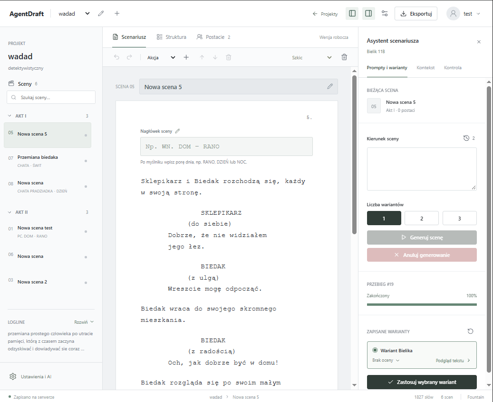](docs/screenshots/scene-editor.png)

## Spis treści

- [Możliwości aplikacji](#możliwości-aplikacji)
- [Widoki aplikacji](#widoki-aplikacji)
- [Architektura i organizacja kodu](#architektura-i-organizacja-kodu)
- [Szybki start przez Docker Compose](#szybki-start-przez-docker-compose)
- [Praca lokalna i rozwój interfejsu](#praca-lokalna-i-rozwój-interfejsu)
- [Lokalny model i sprzęt](#lokalny-model-i-sprzęt)
- [Jak powstaje wariant sceny](#jak-powstaje-wariant-sceny)
- [Konfiguracja środowiska](#konfiguracja-środowiska)
- [API i sesja użytkownika](#api-i-sesja-użytkownika)
- [Model danych i statystyki](#model-danych-i-statystyki)
- [Eksport scenariusza](#eksport-scenariusza)
- [Testy i wyniki pomiarów](#testy-i-wyniki-pomiarów)
- [Zabezpieczenia](#zabezpieczenia)
- [Utrzymanie i rozwiązywanie problemów](#utrzymanie-i-rozwiązywanie-problemów)
- [Ograniczenia obecnej wersji](#ograniczenia-obecnej-wersji)
- [Dokumentacja uzupełniająca](#dokumentacja-uzupełniająca)
- [Autor i licencje](#autor-i-licencje)

## Możliwości aplikacji

### Projekty i struktura opowieści

- Tworzenie i edycja projektów: tytuł, logline, streszczenie, gatunek, grupa docelowa i format scenariusza.
- Biblioteka wszystkich, ostatnio otwieranych i ulubionych projektów; archiwum, kosz i przywracanie.
- Organizacja aktów z własnym tytułem i streszczeniem wydarzeń.
- Dodawanie scen, ustalanie kolejności i przenoszenie ich między aktami.
- Statusy scen: szkic, do sprawdzenia i gotowa.

### Pisanie i postacie

- Edycja w blokach: akcja, postać, dialog, wskazówka aktorska w nawiasach i przejście.
- Osobny nagłówek sceny z rozdzieleniem miejsca akcji i pory dnia.
- Courier New 12 pt w edytorze, powiększenie 50–200%, etykiety typów bloków i sprawdzanie pisowni przeglądarki.
- Nawigacja klawiaturą między blokami, usuwanie pustych elementów oraz grupowane cofanie i ponawianie zmian.
- Profile postaci obejmujące wygląd, przeszłość, psychologię, cele, obawy i sposób mówienia.
- Przypisywanie postaci do sceny oraz lokalna kontrola ich obecności w tekście.
- Zapisywanie zmian do backendu; stan zapisu i błędy widoczne w interfejsie.

### Wsparcie AI

- Generowanie jednej, dwóch lub trzech propozycji dalszego ciągu sceny.
- Kontekst z projektu, aktu, bieżącej sceny, wybranych postaci i fragmentów wcześniejszych scen.
- Plan wydarzeń przygotowany przez Reżysera i recenzja Krytyka z oceną oraz uwagami.
- Wskaźnik postępu, rozwijana lista agentów, ich statusy i czas pracy.
- Anulowanie generowania, odtwarzanie informacji o aktywnym przebiegu po zmianie widoku lub odświeżeniu strony.
- Podgląd wariantu przed zastosowaniem oraz zamiana wcześniej wstawionej propozycji bez wielokrotnego doklejania tego samego tekstu.
- Historia udanych promptów osobno dla każdej sceny; wybranie wpisu uzupełnia pole polecenia.

### Konto, preferencje i eksport

- Rejestracja, logowanie nazwą użytkownika lub e-mailem, wylogowanie i zmiana hasła.
- Profil z nazwą wyświetlaną, adresem zdjęcia i językiem polskim.
- Preferencje opisów akcji, tonu dialogów, wskazówek aktorskich i temperatury modelu.
- Statystyki projektów, scen, słów, postaci, generowania i ostatniej aktywności.
- Eksport projektu do Fountain, Final Draft XML (`.fdx`), PDF i JSON.

## Widoki aplikacji

Zrzuty prezentują aplikację z roboczymi danymi. Każdy obraz można otworzyć w pełnym rozmiarze.

### Biblioteka projektów

Dashboard jest punktem wejścia do projektów i ich kolekcji. Pozwala dodać projekt, edytować jego opis oraz przejść do edytora.

[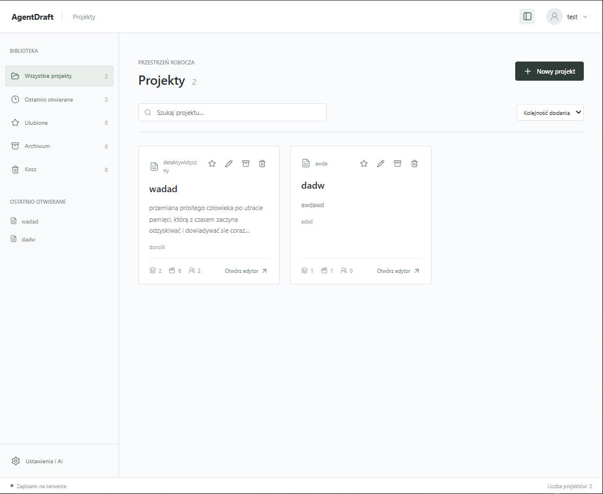](docs/screenshots/dashboard.png)

### Struktura i baza postaci

| Akty i sceny | Profile bohaterów |
|:---:|:---:|
| [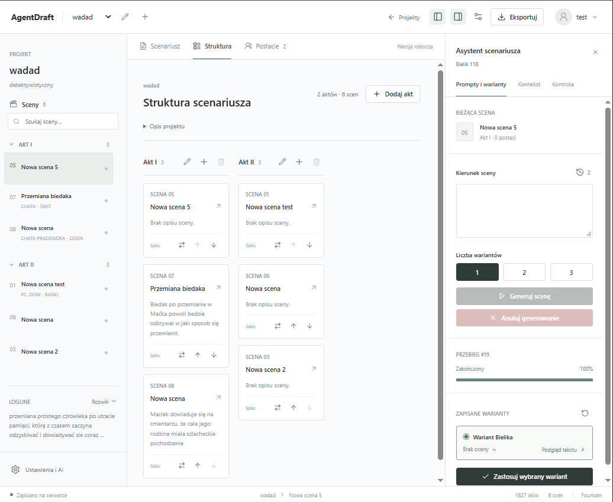](docs/screenshots/structure.png) | [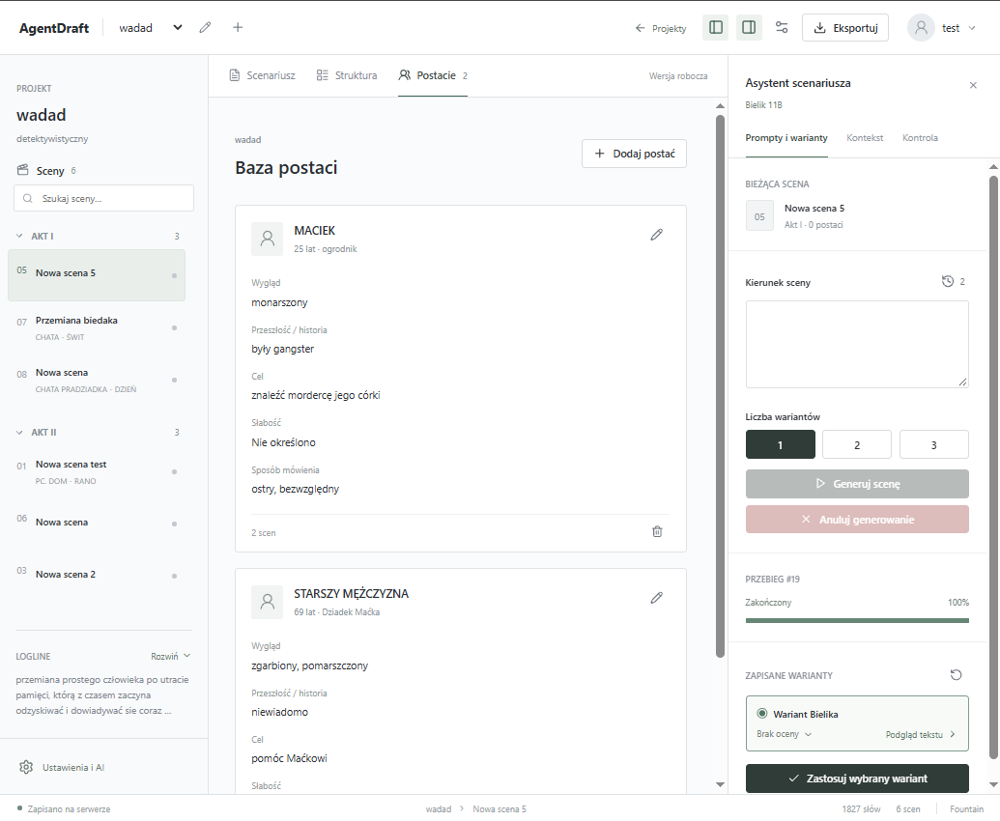](docs/screenshots/characters.png) |

### Dostęp do konta

| Logowanie | Rejestracja |
|:---:|:---:|
| [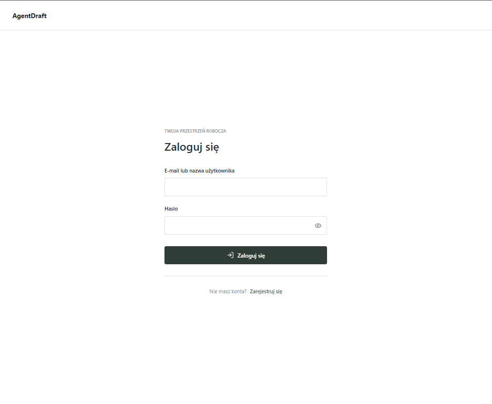](docs/screenshots/login.png) | [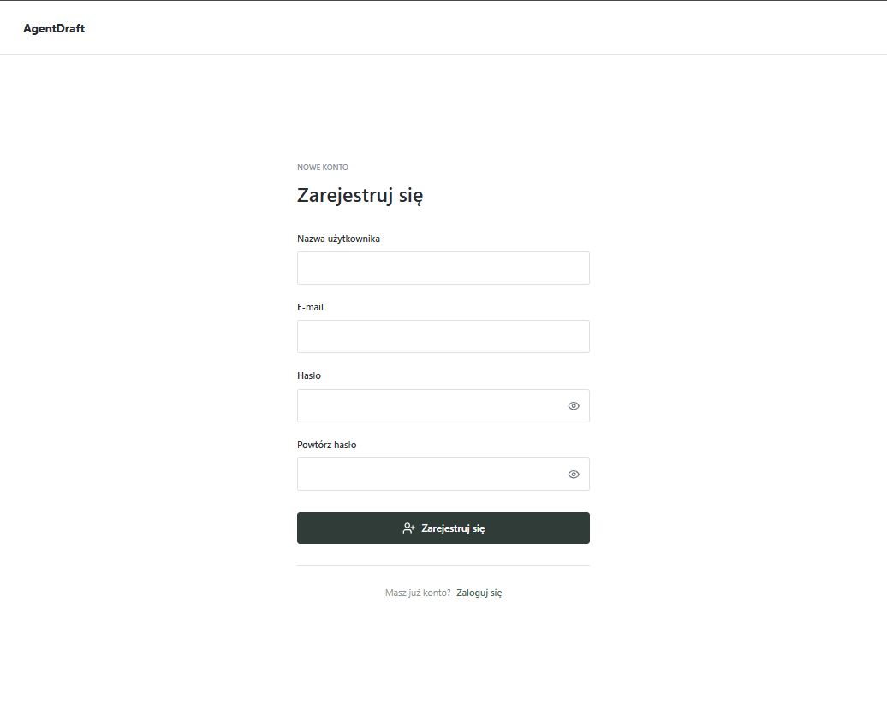](docs/screenshots/registration.png) |

### Ustawienia osobiste

| Moje konto | Preferencje AI |
|:---:|:---:|
| [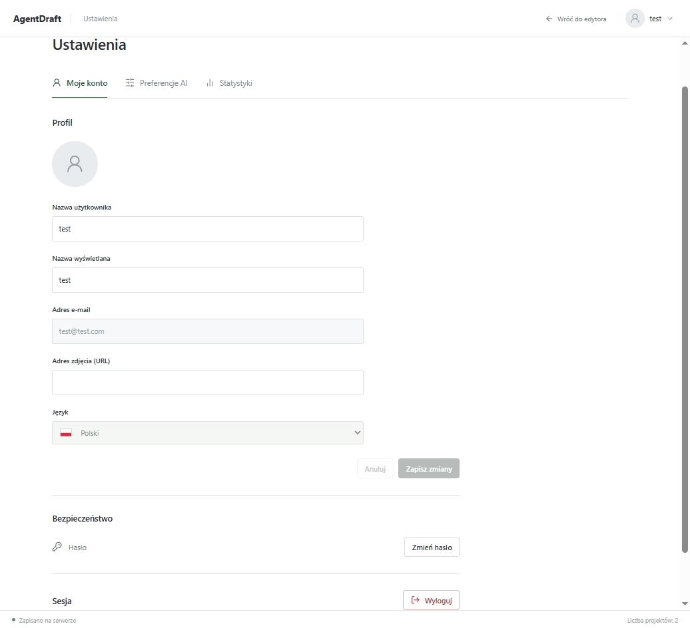](docs/screenshots/account.png) | [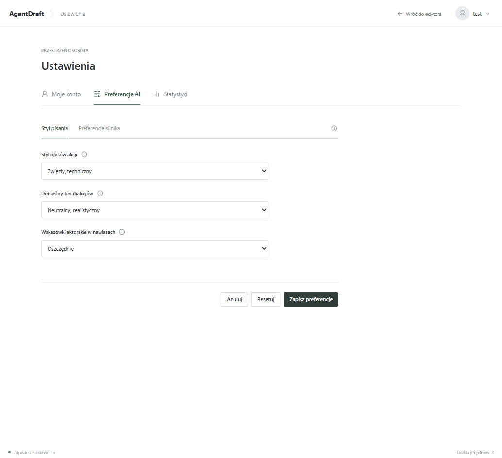](docs/screenshots/ai-preferences.png) |

### Statystyki pracy

[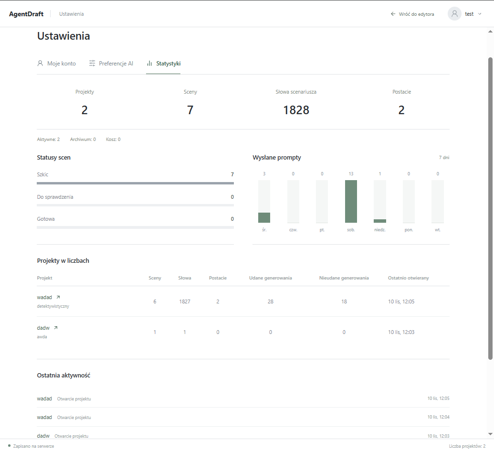](docs/screenshots/statistics.png)

## Architektura i organizacja kodu

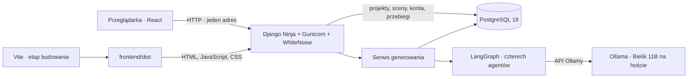

### Stos technologiczny

| Warstwa | Technologie używane w projekcie |
| --- | --- |
| Backend | Python 3.13, Django 6.1, Django Ninja 1.7, Pydantic 2 |
| Agenci | LangChain Core, LangChain Ollama, LangGraph |
| Frontend | React 19, TypeScript 5.9, Vite 7, Lucide React |
| Dane | PostgreSQL 18, `psycopg2-binary`, pola JSONB |
| Serwowanie aplikacji | Gunicorn 26, WhiteNoise 6.12, Docker Compose |
| Eksport PDF | ReportLab, osadzona czcionka Courier Prime |
| Testy | Django TestCase, Vitest, Testing Library, jsdom, pypdf |

Dokładne wersje zależności backendu określa [requirements.txt](requirements.txt), a narzędzia deweloperskie [requirements-dev.txt](requirements-dev.txt). Zależności frontendu są opisane w [package.json](frontend/package.json) i utrwalone w [package-lock.json](frontend/package-lock.json). Obraz frontendu korzysta z Node.js 24.

### Układ katalogów

```text
AgentDraft/
├── backend/
│   ├── accounts/               # API kont, schematy i preferencje użytkownika
│   ├── agents/                 # Agenci, konfiguracja modelu, graf i serwis generowania
│   ├── api/
│   │   ├── security/           # Middleware, limity, blokady i walidacja wejścia
│   │   ├── management/commands/ # Seed i czyszczenie wygasłych liczników
│   │   ├── migrations/         # Migracje schematu bazy
│   │   ├── api.py              # Endpointy projektów, scen i generowania
│   │   ├── scheams.py          # Kontrakty API scenariusza; zachowana nazwa pliku
│   │   ├── base_schemas.py     # Wspólne podstawy walidacji i odpowiedzi
│   │   ├── models.py           # Modele ERD oraz licznik limitów zapytań
│   │   ├── statistics.py       # Agregacje statystyk i historia aktywności
│   │   ├── exporting.py        # Fountain i Final Draft XML
│   │   └── screenplay_pdf.py   # Skład PDF
│   ├── assets/fonts/           # Courier Prime wraz z licencją
│   ├── test/                   # api, security, models, agents, screenplay, llm, support
│   ├── frontend.py             # Strona startowa Reacta i nagłówki zasobów
│   ├── gunicorn.conf.py        # Ustawienia procesu aplikacji w kontenerze
│   ├── ollama.py               # Klient HTTP z obsługą anulowania
│   ├── screenplay_schemas.py   # Ustrukturyzowane bloki scenariusza
│   ├── settings.py
│   └── urls.py
├── frontend/
│   ├── src/components/         # Widoki i formularze
│   ├── src/hooks/              # Sesja, projekty, edytor i generowanie
│   ├── src/services/           # Klient API, mapowanie danych, eksport
│   ├── tests/                  # Testy API, hooków, usług, komponentów i integracji
│   └── dist/                   # Wynik budowania, generowany lokalnie lub w Dockerze
├── docs/
│   ├── screenshots/            # Zrzuty aplikacji użyte w README
│   ├── ERD/                    # Diagram bazy
│   └── *.md                    # Raporty i dokumentacja szczegółowa
├── deployment/                 # Wyłącznie teoretyczne przykłady wdrożeniowe
├── compose.yaml
├── Dockerfile
├── manage.py
├── .env.example
├── requirements.txt
├── requirements-dev.txt
└── LICENSE
```

Dane trwałe i zapytania ORM obsługuje Django. Agenci są bezstanowi: otrzymują polecenie i przygotowany kontekst, a zwracają wynik. Nie pobierają samodzielnie rekordów z bazy. Połączenie modeli Django z grafem znajduje się w [backend/agents/services.py](backend/agents/services.py).

## Szybki start przez Docker Compose

### Wymagania

- Docker z obsługą kontenerów Linux i Docker Compose, np. Docker Desktop w Windows.
- Ollama zainstalowana i uruchomiona na komputerze gospodarza.
- Miejsce na obraz aplikacji, dane PostgreSQL i model Bielik 11B.
- Sprzęt zdolny uruchomić model; sprawdzoną konfigurację opisano w sekcji [Lokalny model i sprzęt](#lokalny-model-i-sprzęt).

Przy uruchomieniu przez Compose Python i Node.js działają w etapach obrazu. Ollama pozostaje usługą hosta. Komendy poniżej wykonuj w katalogu głównym projektu; przykłady lokalne używają PowerShella.

### 1. Przygotuj Ollamę

Pobierz model wskazany w konfiguracji aplikacji:

```powershell
ollama pull SpeakLeash/bielik-11b-v2.3-instruct:Q4_K_M
ollama list
```

Ollama musi działać przed pierwszym generowaniem. Instalację i model opisuje [strona Bielika w Ollamie](https://ollama.com/SpeakLeash/bielik-11b-v2.3-instruct). Sam edytor i ręczna praca nad scenariuszem mogą działać bez uruchamiania generowania.

### 2. Uzupełnij środowisko

Dla nowej instalacji utwórz `.env` na podstawie szablonu. Poniższa komenda zachowuje istniejący plik:

```powershell
if (-not (Test-Path .env)) { Copy-Item .env.example .env }
```

Ustaw własne wartości co najmniej dla `DJANGO_SECRET_KEY`, `POSTGRES_PASSWORD` i `SEED_DEMO_PASSWORD`. Hasło danych demonstracyjnych musi mieć minimum 12 znaków. Przykładowy układ podstawowych zmiennych:

```dotenv
APP_PORT=8000
DJANGO_DEBUG=True
DJANGO_SECRET_KEY=uzupelnij_wlasnym_losowym_kluczem
DJANGO_ALLOWED_HOSTS=localhost,127.0.0.1,[::1]

POSTGRES_DB=agentdraft
POSTGRES_USER=agentdraft
POSTGRES_PASSWORD=uzupelnij_wlasnym_haslem_bazy
POSTGRES_HOST=127.0.0.1
POSTGRES_PORT=55432

SEED_DEMO_PASSWORD=uzupelnij_wlasnym_haslem_demo
```

Wartości `uzupelnij_...` są miejscami do zastąpienia, nie gotowymi hasłami. Losowy klucz można wygenerować bez lokalnej instalacji Pythona:

```powershell
docker run --rm python:3.13-slim python -c "import secrets; print(secrets.token_urlsafe(64))"
```

Plik `.env` zawiera sekrety i nie jest dołączany do obrazu. Lokalny tryb HTTP korzysta z `DJANGO_DEBUG=True`; wymagania trybu bez DEBUG opisuje sekcja [Zabezpieczenia](#zabezpieczenia).

### 3. Zbuduj i uruchom

```powershell
docker compose config --quiet
docker compose up -d --build
```

Kolejność uruchomienia:

1. Docker buduje Reacta i kopiuje `frontend/dist` do obrazu Pythona.
2. `collectstatic` zbiera zasoby frontendu i panelu administracyjnego podczas budowania obrazu.
3. PostgreSQL uruchamia się z trwałym wolumenem i przechodzi kontrolę gotowości.
4. `db_setup` wykonuje migracje; w trybie DEBUG dodaje brakujące dane demonstracyjne.
5. Po pomyślnym zakończeniu setupu `app` uruchamia Django przez Gunicorna.

### 4. Otwórz aplikację

**Adres aplikacji: http://127.0.0.1:8000/**

| Adres | Zastosowanie |
| --- | --- |
| `http://127.0.0.1:8000/#login` | Logowanie |
| `http://127.0.0.1:8000/#register` | Rejestracja |
| `http://127.0.0.1:8000/#projects` | Biblioteka projektów po zalogowaniu |
| `http://127.0.0.1:8000/#settings` | Ustawienia konta |
| `http://127.0.0.1:8000/admin/` | Panel Django dla konta administracyjnego |
| `http://127.0.0.1:8000/api/docs` | Dokumentacja API, dostępna w DEBUG |
| `http://127.0.0.1:8000/api/openapi.json` | Schemat OpenAPI, dostępny w DEBUG |

Nawigacja Reacta używa fragmentów adresu, np. `#project/1`. Aktywna sesja może od razu przywrócić zalogowanego użytkownika. Oddzielny serwer Vite nie jest wymagany do korzystania ze zbudowanego interfejsu.

Jeżeli port 8000 jest zajęty, ustaw np. `APP_PORT=8001` w `.env` i ponów `docker compose up -d`. Wtedy aplikacja działa pod `http://127.0.0.1:8001/`; adres API automatycznie podąża za adresem strony.

### Usługi i dane demonstracyjne

| Usługa | Rola | Dostęp z hosta |
| --- | --- | --- |
| `app` | Django, API, gotowy React, WhiteNoise i Gunicorn | `127.0.0.1:8000`, zmieniane przez `APP_PORT` |
| `db` | PostgreSQL 18 | `127.0.0.1:55432`, zmieniane przez `POSTGRES_PORT` |
| `db_setup` | Migracje i lokalne seedowanie; kończy pracę po wykonaniu zadania | Bez własnego portu |

Poprawny stan: `db` jest `healthy`, `db_setup` zakończył się kodem `0`, a `app` działa. Weryfikacja:

```powershell
docker compose ps --all
docker compose logs --tail=60 db_setup
docker compose logs --tail=60 app
(Invoke-WebRequest http://127.0.0.1:8000/api/auth/csrf).StatusCode
```

Seed przygotowuje dwa zwykłe konta: `demo_writer` i `demo_editor`. Ich początkowe hasło pochodzi z `SEED_DEMO_PASSWORD`. Na pustej bazie powstają 2 projekty, 6 aktów, 4 postacie, 6 scen, powiązania obsady oraz przykładowe prompty, przebiegi i warianty. To dane demonstracyjne, a nie wynik rzeczywistego generowania przy starcie.

Seed działa transakcyjnie, dodaje brakujące rekordy i zachowuje istniejące hasła oraz dane. Jest dostępny tylko przy `DJANGO_DEBUG=True`. Konta demo nie mają uprawnień administratora.

## Praca lokalna i rozwój interfejsu

Ten wariant uruchamia PostgreSQL w Dockerze, a Django w lokalnym środowisku Python. Wymaga Pythona 3.13 oraz Node.js i npm; do budowania obrazu używany jest Node.js 24. Przygotuj wcześniej `.env` i Ollamę zgodnie z instrukcją startową.

### Django i gotowy frontend

Dla nowego środowiska:

```powershell
python -m venv venv
.\venv\Scripts\python.exe -m pip install -r requirements-dev.txt
docker compose up -d db
.\venv\Scripts\python.exe manage.py migrate
.\venv\Scripts\python.exe manage.py seed_db
npm --prefix frontend ci
npm --prefix frontend run build
.\venv\Scripts\python.exe manage.py collectstatic --noinput
.\venv\Scripts\python.exe manage.py runserver
```

W istniejącym środowisku używaj dotychczasowego `venv`. `requirements-dev.txt` obejmuje zależności aplikacji i narzędzia potrzebne do testów. Opcjonalny krok `seed_db` można pominąć, jeśli chcesz zacząć od własnego konta i pustej biblioteki.

Aplikacja jest dostępna pod `http://127.0.0.1:8000/`. WhiteNoise obsługuje pliki zebrane przez `collectstatic` również w Windows. Jeśli wcześniej działa kontener `app` na tym samym porcie, zatrzymaj go przez `docker compose stop app`.

### Vite podczas pracy nad Reactem

Przy uruchomionym Django, w drugim terminalu:

```powershell
npm --prefix frontend run dev
```

Interfejs deweloperski działa zwykle na `http://127.0.0.1:5173/`. Vite przekazuje `/api/` do `http://127.0.0.1:8000`, dzięki czemu klient nadal używa względnego adresu API. Gdy port jest zajęty, sprawdź adres wypisany przez Vite.

Aby zobaczyć zmiany Reacta pod adresem Django, ponów:

```powershell
npm --prefix frontend run build
.\venv\Scripts\python.exe manage.py collectstatic --noinput
```

W kontenerze kod jest częścią obrazu — zmiany backendu lub frontendu wymagają przebudowania przez `docker compose up -d --build`. Zwykły restart kontenera nie buduje nowej wersji.

## Lokalny model i sprzęt

Aplikacja używa modelu **`SpeakLeash/bielik-11b-v2.3-instruct:Q4_K_M`**. Nazwa jest ustalona w [backend/ollama.py](backend/ollama.py); pole modelu w ustawieniach użytkownika jest tylko do odczytu.

| Sposób uruchomienia Django | Domyślny adres Ollamy |
| --- | --- |
| Lokalny Python | `http://127.0.0.1:11434` |
| Kontener `app` | `http://host.docker.internal:11434` |

Model nie jest pobierany przez Compose i nie trafia do obrazu aplikacji. Pobiera go użytkownik komendą `ollama pull`; jego przechowywaniem i wykorzystaniem GPU zarządza Ollama na hoście.

### Dostęp z kontenera

Ollama musi nasłuchiwać pod adresem osiągalnym z sieci Dockera. Inny adres można ustawić przez `OLLAMA_DOCKER_BASE_URL` w `.env`. Do sprawdzenia połączenia wystarczy odczyt listy modeli, bez inferencji:

```powershell
docker compose exec app python -c "import os, urllib.request; r=urllib.request.urlopen(os.environ['OLLAMA_BASE_URL']+'/api/tags', timeout=5); print(r.status)"
```

Jeśli to żądanie nie przechodzi, sprawdź nasłuch Ollamy, zaporę i adres hosta. Konfigurację `OLLAMA_HOST` oraz sposób ponownego uruchomienia usługi opisuje [oficjalne FAQ Ollamy](https://docs.ollama.com/faq). Dostęp do jej API ogranicz do komputera i zaufanej sieci Dockera.

### Wykorzystanie GPU

Podczas generowania wykonaj na hoście:

```powershell
ollama ps
```

Kolumna `PROCESSOR` pokazuje, czy model korzysta z GPU, CPU czy obu. Żądanie offloadu w kliencie nie gwarantuje, że cały model zmieści się w VRAM; znaczenie mają także kontekst i pozostałe obciążenie pamięci. [Opis w dokumentacji Ollamy](https://docs.ollama.com/faq#how-can-i-tell-if-my-model-was-loaded-onto-the-gpu).

Udokumentowane próby pomocniczych agentów przeprowadzono na **NVIDIA RTX 3060 Ti 8 GB**, z Bielikiem Q4_K_M i kontekstem 4096 tokenów. To sprawdzony profil testowy, nie zadeklarowane minimalne wymagania. Obsługi laptopa z 6 GB VRAM nie potwierdzono osobnym pomiarem. Szczegóły znajdują się w [raporcie porównawczym](docs/agent-brevity-comparison.md).

## Jak powstaje wariant sceny

### Kontekst wejściowy

Po wybraniu generowania backend pobiera zapisany stan sceny i tworzy snapshot kontekstu. Obejmuje on:

- tytuł, logline, streszczenie, gatunek i grupę docelową projektu;
- tytuł, numer i podsumowanie bieżącego aktu;
- nagłówek, treść i metadane bieżącej sceny, w tym jej cel i notatki;
- profile postaci przypisanych do sceny;
- preferencje stylu pisania i parametry generowania;
- maksymalnie 3 wcześniejsze niepuste sceny, po maksymalnie 1200 końcowych znaków ich treści.

Wcześniejsze sceny są wybierane z tego samego projektu według kolejności aktów i scen. Bieżąca treść i streszczenia planowanych wydarzeń pełnią różne role — model może je jednak błędnie zinterpretować, dlatego końcowy tekst wymaga kontroli autora.

**Przypisanie postaci jest źródłem ich profili dla agentów.** Samo wpisanie imienia w prompcie nie dodaje relacji w bazie ani pełnej karty bohatera do obsady. Dla istniejącej postaci wybierz ją również w kontekście sceny. Etykiety dialogowe mają zachowywać kanoniczne nazwy zaznaczonych bohaterów.

### Zadania agentów

| Agent | Dane i wynik |
| --- | --- |
| **Archiwista** | Porządkuje przekazane profile i fragmenty wcześniejszych scen. Zwraca kontekst postaci, fakty ciągłości i otwarte wątki. |
| **Reżyser** | Przekłada polecenie autora i kontekst na krótką listę punktów planu — beats. Nie pisze gotowych dialogów. |
| **Scenarzysta** | Realizuje plan w ustrukturyzowanych blokach akcji i wypowiedzi, uwzględniając style mówienia oraz preferencje autora. |
| **Krytyk** | Ocenia postacie, ciągłość, zgodność z poleceniem i format scenariusza. Zwraca ocenę, uzasadnienie i konkretne uwagi. |

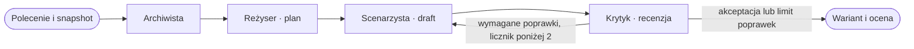

Po negatywnej recenzji Scenarzysta otrzymuje poprzedni draft i wymagane zmiany. Dopuszczalne są **najwyżej 2 poprawki po pierwszym draftcie**. Status `revision_limit_reached` oznacza zakończenie limitowanej pętli z pozostającymi uwagami; nie oznacza akceptacji jakości przez Krytyka.

Agenci korzystają z LangChain i schematów Pydantic. Błędna struktura odpowiedzi może uruchomić ograniczoną próbę naprawy. Archiwista ma ścieżkę awaryjną zachowującą dostarczony materiał źródłowy, gdy jego podsumowanie nie spełnia kontraktu.

### Jeden, dwa lub trzy warianty

Warianty powstają **sekwencyjnie**. Po pierwszym przebiegu wynik Archiwisty jest używany ponownie w pozostałych wariantach danego generowania. Reżyser, Scenarzysta i Krytyk wykonują własne etapy dla kolejnych propozycji.

Scenarzysta używa tej samej temperatury użytkownika we wszystkich wariantach. Dodatkowe wskazówki kolejnych podejść akcentują zrównoważony przebieg, relację i podtekst albo obraz i działanie. Agenci pomocniczy pracują z temperaturą `0`. Dialog i wskazówki aktorskie zależą od sytuacji oraz preferencji — nie ma wymogu dodawania dialogu do każdej sceny.

Zestaw wariantów jest zapisywany dopiero po pomyślnym wygenerowaniu wszystkich wybranych propozycji. Błąd albo anulowanie nie publikuje niepełnego zestawu jako udanego wyniku. Rekordy diagnostyczne nieudanego przebiegu pozostają w bazie.

### Podgląd, zastosowanie i historia

- Wygenerowany tekst jest propozycją; nie zmienia sceny przed zastosowaniem przez autora.
- Wariant zawiera dalszy ciąg bez zamierzonego powtarzania zapisanej treści.
- Pierwsze zastosowanie dopisuje propozycję z zachowaniem wcześniejszego tekstu. Zmiana wariantu podmienia jego poprzednio wstawione bloki; ponowne zastosowanie tego samego jest idempotentne.
- Zastosowanie wariantu można cofnąć w edytorze. Równoczesne, niezgodne zmiany tekstu i bloków mogą wymagać najpierw zapisania sceny.
- Nagłówek może być wymyślony dla pustej sceny bez nagłówka; istniejący nagłówek jest częścią kontekstu.
- Panel prezentuje warianty ostatniego udanego generowania; starsze rekordy pozostają dostępne w danych przebiegów.
- Historia promptów pokazuje żądania z poprawnie zakończonym generowaniem. Wybranie wpisu kopiuje polecenie do edytowalnego pola.

Generowanie jest synchroniczne po stronie API, a postęp pobierany osobnymi żądaniami. Globalna blokada PostgreSQL dopuszcza jedno generowanie naraz dla całej aplikacji. Anulowanie zatrzymuje transport; w tym przebiegu nie jest publikowana częściowa odpowiedź modelu.

## Konfiguracja środowiska

Szablon podstawowy to [.env.example](.env.example). Lokalny Django wczytuje `.env`; istniejące zmienne procesu mają pierwszeństwo. Compose przekazuje środowisko do aplikacji i nadpisuje adresy usług kontenerowych.

### Aplikacja, baza i proces

| Zmienna | Wartość domyślna lub szablon | Znaczenie |
| --- | --- | --- |
| `DJANGO_SECRET_KEY` | Wymagana | Sekret Django; własna losowa wartość. |
| `DJANGO_DEBUG` | `True` w `.env.example`; brak zmiennej w Django oznacza `False` | Lokalny tryb pracy i dostępność dokumentacji API. |
| `DJANGO_ALLOWED_HOSTS` | `localhost,127.0.0.1,[::1]` | Dozwolone hosty HTTP. |
| `APP_PORT` | `8000` | Port aplikacji na hoście. |
| `POSTGRES_DB` | `agentdraft` w szablonie | Nazwa bazy. |
| `POSTGRES_USER` | `agentdraft` w szablonie | Użytkownik bazy. |
| `POSTGRES_PASSWORD` | Wymagana | Hasło bazy. |
| `POSTGRES_HOST` | Lokalnie `127.0.0.1`; w Compose `db` | Host PostgreSQL. |
| `POSTGRES_PORT` | Lokalnie `55432`; w kontenerze `5432` | Port połączenia; zmienna zmienia też publikowany port bazy. |
| `SEED_DEMO_PASSWORD` | Wymagana przez Compose | Początkowe hasło kont demonstracyjnych; minimum 12 znaków. |
| `OLLAMA_BASE_URL` | Lokalnie `http://127.0.0.1:11434` | Adres Ollamy dla Pythona uruchomionego na hoście. |
| `OLLAMA_DOCKER_BASE_URL` | `http://host.docker.internal:11434` | Adres Ollamy przekazywany do kontenera jako `OLLAMA_BASE_URL`. |
| `GUNICORN_WORKERS` | `1` | Liczba procesów aplikacji w kontenerze. |
| `GUNICORN_THREADS` | `4` | Wątki pozwalające m.in. odpytywać postęp podczas generowania. |
| `GUNICORN_TIMEOUT` | `930` s | Ustawienie timeoutu procesu Gunicorna; osobny limit generowania wynosi 900 s. |

Opcjonalne `DJANGO_DB_USER` i `DJANGO_DB_PASSWORD` wybierają osobną rolę połączenia Django. Przykłady ograniczenia uprawnień w `deployment/` pozostają materiałem teoretycznym; Compose nie tworzy automatycznie takiej roli.

### Sesja i HTTP

| Zmienna | Działanie |
| --- | --- |
| `CORS_ALLOWED_ORIGINS` | Dokładne dozwolone originy; lokalne wartości w szablonie obejmują porty Vite. |
| `CSRF_TRUSTED_ORIGINS` | Originy uprawnione do żądań modyfikujących dane. |
| `SESSION_COOKIE_SAMESITE`, `CSRF_COOKIE_SAMESITE` | Domyślnie `Lax`. |
| `SESSION_COOKIE_SECURE`, `CSRF_COOKIE_SECURE` | Domyślnie zależą od DEBUG; bez DEBUG wymagane `True`. |
| `DJANGO_SECURE_SSL_REDIRECT` | Domyślnie włączone bez DEBUG. |
| `DJANGO_TRUSTED_PROXY_IPS` | Domyślnie puste; zaufanie tylko dla wskazanych adresów proxy. |
| `DJANGO_HSTS_INCLUDE_SUBDOMAINS`, `DJANGO_HSTS_PRELOAD` | Opcjonalne rozszerzenia HSTS; domyślnie wyłączone. |

Przy wspólnym adresie frontendu i API nie jest potrzebne zezwalanie na inne originy. Wartości `SameSite=None` wymagają bezpiecznych ciasteczek. Obsługa zewnętrznego SMTP jest konfigurowana przez `DJANGO_SMTP_HOST`, `DJANGO_SMTP_PORT`, `DJANGO_SMTP_USER` i `DJANGO_SMTP_PASSWORD`; aplikacja nie udostępnia obecnie resetowania hasła przez e-mail.

### Preferencje w profilu

| Ustawienie | Dostępne wartości lub zachowanie |
| --- | --- |
| Styl opisów akcji | Zwięzły, techniczny / Plastyczny, opisowy. |
| Ton dialogów | Zestaw gotowych tonów albo własny opis; domyślnie „Neutralny, realistyczny”. |
| Wskazówki aktorskie | Wyłączone / Oszczędnie / Standardowo. Standardowo nadal oznacza wskazówki dopasowane do sytuacji. |
| Temperatura | `0.0–1.0`, krok `0.1`, domyślnie `0.7`; wpływa na Scenarzystę. |
| Model | Bielik 11B; tylko odczyt. |
| Maksymalna odpowiedź | `2048` tokenów; pole zablokowane w UI, techniczny budżet wyjścia strukturalnego. |

Nazwa modelu, podstawowe parametry transportu i kontekstu są zdefiniowane w kodzie [backend/ollama.py](backend/ollama.py), a budżety agentów w [serwisie generowania](backend/agents/services.py). Nie wszystkie stałe mają odpowiedniki w `.env`. Jawne wywołanie API może przekazać `generation_parameters` w granicach schematu; nie zmienia to zablokowanego ustawienia długości w profilu.

Domyślny adres frontendu do API to `/api/`. Opcjonalna zmienna `VITE_API_BASE_URL` jest odczytywana **podczas budowania**; nie zawiera sekretów. Docker używa domyślnego wspólnego originu i wyklucza pliki `.env` frontendu z kontekstu obrazu. Zmiana zmiennej środowiskowej już działającego kontenera nie przebudowuje JavaScriptu.

## API i sesja użytkownika

Główne endpointy są zaimplementowane w [backend/api/api.py](backend/api/api.py). Router kont znajduje się w [backend/accounts/api.py](backend/accounts/api.py) i jest podpięty do tego samego NinjaAPI. Schematy danych znajdują się odpowiednio w `backend/api/scheams.py` i `backend/accounts/schemas.py`.

Ścieżki w tabeli są względne wobec **`/api`** i nie mają końcowego ukośnika. Dokumentacja interaktywna i OpenAPI są wyłączone poza DEBUG.

| Obszar | Metody i ścieżki |
| --- | --- |
| Sesja | `GET /auth/csrf`, `POST /auth/register`, `POST /auth/login`, `POST /auth/logout` |
| Konto | `GET/PATCH /users/me`, `POST /users/me/password` |
| Profil i preferencje | `GET/PATCH /users/me/profile`, `GET/PUT /users/me/preferences` |
| Statystyki | `GET /users/me/statistics` |
| Projekty | `GET/POST /projects`, `GET/PATCH/DELETE /projects/{project_id}` |
| Biblioteka i workspace | `POST /projects/{project_id}/actions/{action}`, `GET /projects/{project_id}/workspace` |
| Eksport | `GET /projects/{project_id}/export?format=fountain`, `fdx` lub `pdf` |
| Akty | `GET/POST /projects/{project_id}/acts`, `GET/PATCH/DELETE /acts/{act_id}` |
| Postacie | `GET/POST /projects/{project_id}/characters`, `GET/PATCH/DELETE /characters/{character_id}` |
| Sceny | `GET/POST /projects/{project_id}/scenes`, `GET/PATCH/DELETE /scenes/{scene_id}` |
| Obsada sceny | `GET/POST /scenes/{scene_id}/cast`, `GET/PATCH/DELETE /cast/{cast_id}` |
| Prompty | `GET/POST /scenes/{scene_id}/prompts`, `GET /prompts/{prompt_id}`, `GET /prompts/{prompt_id}/run` |
| Generowanie | `POST /scenes/{scene_id}/generate`, `GET /generation/active` |
| Anulowanie | `POST /scenes/{scene_id}/cancel-generation` |
| Przebiegi | `GET /scenes/{scene_id}/runs`, `GET /runs/{run_id}` |
| Praca agentów | `GET /runs/{run_id}/agents`, `GET /agent-executions/{execution_id}` |
| Warianty | `GET /runs/{run_id}/variants`, `GET /scenes/{scene_id}/variants`, `GET /variants/{variant_id}`, `POST /variants/{variant_id}/select` |

Listy korzystają z paginacji `?limit=20&offset=0`, z maksymalnym limitem 100, i zwracają `{ "items": [...], "count": n }`. Projekty można filtrować przez `search` i `collection` (`all`, `recent`, `favorites`, `archive`, `trash`). Operacje na kolekcjach to `favorite`, `unfavorite`, `archive`, `unarchive`, `trash`, `restore` i `open`.

`PATCH` zmienia tylko przekazane pola; przekazany obiekt JSON zastępuje całe pole, zamiast wykonywać automatyczne scalanie. Przeniesienie sceny odbywa się przez zmianę jej `act_id` w tym samym projekcie. Usunięcie aktu z przypisanymi scenami zwraca `409`. Kosz oznacza miękkie usunięcie projektu, a `DELETE` trwale usuwa zasób i powiązane rekordy zgodnie z relacjami.

### Uwierzytelnianie

API korzysta z ciasteczka sesji Django. Klient [frontend/src/services/api.ts](frontend/src/services/api.ts):

1. Dołącza `credentials: 'include'` do żądań.
2. Pobiera CSRF przez `GET /api/auth/csrf` i korzysta z ciasteczka lub zwróconego tokenu.
3. Wysyła `X-CSRFToken` przy `POST`, `PUT`, `PATCH` i `DELETE`, również przy logowaniu i rejestracji.
4. Obsługuje błędy HTTP oraz utratę sesji.

Logowanie i rejestracja obracają token CSRF. Integracje zewnętrzne powinny zachować ciasteczka i odświeżyć token po zalogowaniu. Przykładowe dane logowania:

```json
{
  "identifier": "nazwa_uzytkownika_lub_email",
  "password": "haslo"
}
```

### Generowanie i zastosowanie propozycji

Przykładowy payload `POST /api/scenes/{scene_id}/generate`:

```json
{
  "user_prompt": "Kontynuuj scenę: Anna zauważa brak listu i próbuje ukryć to przed bratem. Zakończ jej decyzją o powrocie na stację.",
  "variant_count": 2
}
```

Opcjonalny `generation_id` jest identyfikatorem UUID używanym do powiązania rozpoczęcia i anulowania przebiegu. Parametry generowania bez jawnego nadpisania pochodzą z preferencji użytkownika. `POST /scenes/{scene_id}/prompts` zapisuje samo żądanie i snapshot; generowanie uruchamia endpoint `/generate`.

Aby zastosować wariant, wyślij do `POST /api/variants/{variant_id}/select`:

```json
{ "apply_to_scene": true }
```

Wartość `false` oznacza sam wybór propozycji. Przebiegi, logi agentów i warianty są tworzone przez silnik; publiczne API nie udostępnia ich dowolnego tworzenia, edycji ani usuwania jako zwykłego CRUD.

## Model danych i statystyki

[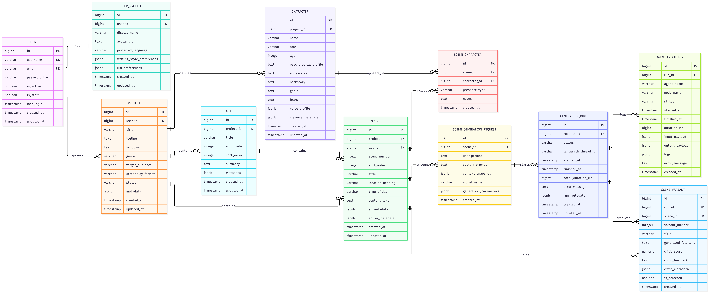](docs/ERD/DB_diagram_ERD.png)

Modele znajdują się w [backend/api/models.py](backend/api/models.py). Schemat obejmuje 11 encji domenowych i dodatkowy model techniczny limitów zapytań:

| Encja | Przechowywane informacje |
| --- | --- |
| `User` | Konto Django, unikalna nazwa i e-mail, bezpiecznie hashowane hasło. |
| `UserProfile` | Profil, język, preferencje pisania i silnika. |
| `Project` | Właściciel, opis opowieści i metadane biblioteki. |
| `Act` | Numer, kolejność, tytuł i streszczenie aktu. |
| `Character` | Profil bohatera, jego cele, obawy, przeszłość i głos. |
| `Scene` | Akt, kolejność, nagłówek, pora dnia, tekst i metadane edytora/AI. |
| `SceneCharacter` | Obsada sceny, rodzaj obecności i notatki. |
| `SceneGenerationRequest` | Polecenie, snapshot kontekstu, model i parametry. |
| `GenerationRun` | Status, czas, metadane i błąd przebiegu. |
| `AgentExecution` | Etap, wejście, wyjście, logi oraz czas pracy agenta. |
| `SceneVariant` | Wygenerowany tekst, ocena, uwagi Krytyka i zaznaczenie wariantu. |
| `RequestRateLimit` | Hash klucza limitu, licznik i termin wygaśnięcia. |

Pola metadanych używają `JSONField(default=dict)`, przechowywanego w PostgreSQL jako JSONB. `Scene.content_text` zawiera tekst, a `Scene.editor_metadata` m.in. typy i identyfikatory bloków. `location_heading` i `time_of_day` są oddzielnymi polami. Relacje i walidacja blokują łączenie zasobów należących do różnych projektów.

Aplikacja `accounts` wydziela obsługę kont, ale modele `User` i `UserProfile` zachowują dotychczasowe tabele w `api`. `AUTH_USER_MODEL` ma wartość `api.User`.

### Skąd pochodzą statystyki

Statystyki powstają z zapisanych danych, a nie z losowych wartości:

- backend agreguje projekty, sceny, postacie, prompty, warianty i przebiegi;
- udane i nieudane generowania liczone są ze statusów `GenerationRun`; anulowanie ma osobny status;
- liczba słów i rozkład statusów scen wynikają z pobranych tekstów oraz metadanych scen;
- wykres promptów pokazuje aktywność na podstawie dat zapisanych żądań;
- historia łączy zdarzenia projektów zapisane w metadanych z wynikami generowania i prezentuje 5 ostatnich aktywności.

API statystyk uwzględnia strefę czasową; interfejs pokazuje aktywność promptów z ostatnich 7 dni. Dane demonstracyjne również wpływają na te zestawienia. Nie ma osobnej tabeli z gotowymi kafelkami dashboardu.

## Eksport scenariusza

| Format | Zastosowanie |
| --- | --- |
| **Fountain** | Tekstowy zapis scenariusza z oznaczeniami jego elementów. |
| **Final Draft XML (`.fdx`)** | Typowane akapity scenariusza i ustawienia formatowania. |
| **PDF** | Gotowy dokument z osadzoną czcionką i paginacją. |
| **JSON** | Zrzut bieżących danych workspace, przygotowany przez frontend po ponownym odczycie projektu. |

Fountain, FDX i PDF są generowane w backendzie z typowanych bloków scen. JSON nie jest pełną kopią bazy ani formatem zaimplementowanego importu. Przed eksportem interfejs zapisuje oczekujące zmiany.

### Układ PDF

Eksporter wykorzystuje ReportLab oraz Courier Prime 12 pt z polskimi znakami. Dokument ma format **US Letter — 8,5 × 11 cali**, skok wiersza 12 pt, lewy margines akcji 1,5 cala i prawy, górny oraz dolny margines po 1 calu. Nagłówki scen są wielkimi literami.

Pozycje poziome liczone od lewej krawędzi strony:

| Element | Początek | Prawa granica |
| --- | ---: | ---: |
| Nagłówek / akcja | 1,5 cala | 7,5 cala |
| Postać | 3,7 cala | 7,5 cala |
| Dialog | 2,5 cala | 6,0 cali |
| Wskazówka w nawiasach | 3,1 cala | 5,6 cala |
| Przejście, wyrównane do prawej | 5,0 cali | 7,5 cala |

Skład obejmuje stronę tytułową, dzielenie na strony oraz utrzymywanie powiązanych elementów wypowiedzi. Powiększenie widoku edytora nie zmienia rozmiaru czcionki w eksporcie. Szczegóły: [kod składu PDF](backend/api/screenplay_pdf.py), [eksport Fountain i FDX](backend/api/exporting.py) oraz [opis czcionki](docs/courier-prime.md).

## Testy i wyniki pomiarów

### Uruchamianie testów

Po zainstalowaniu `requirements-dev.txt` i uruchomieniu bazy:

```powershell
.\venv\Scripts\python.exe manage.py test backend.test --keepdb --noinput
.\venv\Scripts\python.exe manage.py check
.\venv\Scripts\python.exe manage.py makemigrations --check --dry-run
.\venv\Scripts\python.exe -m pip check
```

Testy Django korzystają z osobnej bazy testowej. Lokalny użytkownik PostgreSQL musi mieć prawo jej utworzenia; `--keepdb` zachowuje tę bazę między uruchomieniami.

| Katalog testów backendu | Zakres |
| --- | --- |
| `backend/test/api/` | Kontrakty, konto, projekty, struktura, eksport, statystyki i frontend serwowany przez Django. |
| `backend/test/security/` | Logowanie, sesje, CSRF, CORS, uprawnienia, limity i współbieżność. |
| `backend/test/models/` | Relacje ERD, ograniczenia, JSON i seed. |
| `backend/test/agents/` | Agenci, graf, odzyskiwanie odpowiedzi i serwis zapisu. |
| `backend/test/screenplay/` | Typy bloków, format, kontynuacja i stosowanie wariantów. |
| `backend/test/llm/` | Transport Ollamy, generowanie i anulowanie. |
| `backend/test/support/` | Wspólne dane i symulowany transport modelu. |

Wybrany obszar:

```powershell
.\venv\Scripts\python.exe manage.py test backend.test.security
```

Frontend:

```powershell
npm --prefix frontend ci
npm --prefix frontend test
npm --prefix frontend run test:typecheck
npm --prefix frontend run build
```

Testy frontendu są pogrupowane w `frontend/tests/api`, `hooks`, `services`, `components` i `integration`. Używają danych testowych i przechwytują HTTP. Automatyczne testy agentów nie wymagają generowania przez rzeczywistą Ollamę; część testów transportu korzysta z lokalnych gniazd sieciowych.

### Ostatnia udokumentowana weryfikacja integracji

| Kontrola | Wynik zapisany po integracji Django + WhiteNoise |
| --- | --- |
| Backend | 278 testów — poprawnie. |
| Frontend | 231 testów — poprawnie. |
| Typy i build | Kontrola TypeScript, build Vite, kontrola Django i zgodność migracji — poprawnie. |
| Docker | Zbudowane obrazy `app` i `db_setup`. |
| Chrome | HTML, CSS, JavaScript i ikona z jednego originu; formularze kont bez błędów JavaScript; token CSRF wysyłany przy logowaniu. |
| Ollama | Potwierdzony dostęp kontenera do listy modeli, bez uruchamiania inferencji w tej próbie. |

To zapis wcześniejszej weryfikacji opisanej w [dokumencie integracji](docs/single-origin.md). Pomiary jakości modelu są osobną częścią projektu.

### Zwięzłość odpowiedzi agentów pomocniczych

W próbie z 7 listopada 2026 porównano krótsze instrukcje Archiwisty i Krytyka. Wybrane wyniki Krytyka na RTX 3060 Ti 8 GB:

| Próba | Tokeny przed → po | Czas przed → po |
| --- | ---: | ---: |
| Zapisany wariant | 553 → 199 | 28,9 → 11,0 s |
| Scena z celowymi błędami | 762 → 328 | 43,8 → 19,8 s |
| Poprawna scena bez dialogów | 616 → 155 | 36,2 → 8,6 s |

Łącznie w trzech odpowiedziach Krytyka: **1931 → 682 tokeny** oraz **108,9 → 39,4 s**. W dwóch odpowiedziach Archiwisty: 696 → 525 tokenów.

To mała próba porównawcza, a nie statystyczny test jakości ani pomiar pełnego generowania sceny. Oceny i wykrywane błędy nie były identyczne. Jeden pomiar Archiwisty miał znaczne odchylenie, a powtórzenie korzystało z pamięci podręcznej wejścia. Pełne warunki, wyniki i ograniczenia zawiera [raport porównawczy](docs/agent-brevity-comparison.md).

## Zabezpieczenia

- Uwierzytelnianie sesją Django, hashowanie i walidatory haseł, rotacja sesji i tokenu CSRF.
- Kontrola właściciela projektu przy dostępie do scen, postaci, przebiegów i wariantów.
- Weryfikacja CSRF przy zmianach, logowaniu i rejestracji; dokładne listy originów przy CORS.
- Limity wielkości i złożoności danych, długości pól i dopuszczalnych parametrów.
- Bezpieczne wyświetlanie tekstu w Reactcie, walidacja URL-i awatarów i polityka CSP bez skryptów inline.
- `Cache-Control: no-store` dla API i dokumentu interfejsu; ochrona przed osadzaniem strony w ramkach.
- Atomowe liczniki limitów oraz blokada jednoczesnego dostępu do lokalnego modelu w PostgreSQL.
- Proces kontenera jako użytkownik bez uprawnień roota; porty aplikacji i bazy publikowane na interfejsie loopback.
- Agenci nie otrzymują narzędzi do wykonywania shella, dowolnych zapytań SQL ani pobierania wskazanych przez prompt plików i URL-i.

### Limity żądań

| Operacja | Limit |
| --- | --- |
| API — zalogowane konto / anonimowy adres | 1200/min / 120/min |
| Żądania modyfikujące | 300/min na konto lub adres |
| Logowanie | 10/min na IP i 10/5 min na konto lub identyfikator |
| Rejestracja | 5/h na IP |
| Zmiana hasła | 5/15 min na konto |
| Eksport | 10/min na konto |
| Generowanie | 3/min i 30/h na konto |
| Logowanie do panelu admina | 10/min na IP |

Przekroczenie limitu zwraca `429` z `Retry-After`. Zajęty model dla innego konta zwraca `503`; drugie generowanie tego samego konta jest blokowane. Całe generowanie ma limit 900 s. Komunikacja z Ollamą ma osobne timeouty i ograniczenie rozmiaru odpowiedzi.

**Prompt injection pozostaje problemem semantycznym modelu.** Instrukcje systemowe i schematy wyjścia nie gwarantują poprawnej interpretacji każdego polecenia. Wynik modelu jest tekstem scenariusza i nie jest wykonywany jako kod. Krytyk może przeoczyć błąd albo błędnie ocenić poprawną scenę.

Przy `DJANGO_DEBUG=False` wymagany jest silny sekret i bezpieczne ciasteczka, domyślnie aktywowane są przekierowanie HTTPS i HSTS, a dokumentacja API jest wyłączana. Gotowy lokalny Compose nie konfiguruje certyfikatów TLS. Katalog **`deployment/` pozostaje wyłącznie dokumentacją teoretyczną** i nie jest używany do uruchamiania Nginxa ani innych usług przez ten projekt.

Pełny zakres audytu, wyniki kontroli zależności i ograniczenia przed publicznym udostępnieniem: [SECURITY_AUDIT.md](docs/SECURITY_AUDIT.md). Raporty opisują stan w dacie ich przygotowania; bieżący sposób uruchomienia określa niniejsza instrukcja.

## Utrzymanie i rozwiązywanie problemów

### Najczęstsze operacje

| Zadanie | Komenda z katalogu głównego |
| --- | --- |
| Logi aplikacji | `docker compose logs -f app` |
| Logi inicjalizacji | `docker compose logs --tail=100 db_setup` |
| Stan usług | `docker compose ps --all` |
| Kontrola Django w kontenerze | `docker compose exec app python manage.py check` |
| Konto administratora | `docker compose exec app python manage.py createsuperuser` |
| Migracje działającej aplikacji | `docker compose exec app python manage.py migrate --noinput` |
| Ponowne lokalne seedowanie | `docker compose run --rm db_setup python manage.py seed_db` |
| Wygasłe liczniki limitów | `docker compose exec app python manage.py prune_security_limits` |
| Przebudowanie po zmianach kodu | `docker compose up -d --build` |
| Zatrzymanie | `docker compose stop` |
| Usunięcie kontenerów z zachowaniem danych | `docker compose down` |

`prune_security_limits` usuwa wyłącznie wygasłe liczniki; jego okresowe uruchamianie wymaga własnego harmonogramu. Seed działa tylko w DEBUG. Nowe migracje twórz podczas pracy nad modelami lokalną komendą `manage.py makemigrations api`; usługa startowa wykonuje istniejące pliki migracji.

### Trwałość i ręczna kopia bazy

Dane PostgreSQL są w nazwanym wolumenie `postgres_data`, zamontowanym pod `/var/lib/postgresql`. Taki układ odpowiada użytemu obrazowi PostgreSQL 18; szczegóły opisuje [dokumentacja oficjalnego obrazu](https://hub.docker.com/_/postgres).

`docker compose down` zachowuje wolumen. Opcja `--volumes` usuwa również dane i nie jest częścią zwykłego zatrzymywania. Zmiana nazwy użytkownika lub hasła w `.env` nie zmienia automatycznie istniejących poświadczeń we wcześniej utworzonej bazie.

Przykład ręcznej kopii bez przekierowywania binarnego dumpa przez PowerShell:

```powershell
New-Item -ItemType Directory -Force .local-tools/backups | Out-Null
docker compose exec -T db sh -c 'pg_dump -U "$POSTGRES_USER" -d "$POSTGRES_DB" -Fc -f /tmp/agentdraft.dump'
docker compose cp db:/tmp/agentdraft.dump .local-tools/backups/agentdraft.dump
```

Kopia zawiera dane użytkowników i scenariuszy. Przechowuj ją poza publiczną dokumentacją oraz sprawdź odtwarzanie na osobnej bazie przed użyciem jako zabezpieczenia danych. Projekt nie wdraża automatycznych backupów ani harmonogramu retencji.

### Typowe problemy

| Objaw | Co sprawdzić |
| --- | --- |
| Aplikacja nie zajmuje portu 8000 | Inny `runserver` lub kontener; zmień `APP_PORT` i odtwórz usługę `app`. |
| `db_setup` kończy się błędem | Logi usługi, `.env`, hasło demo o długości minimum 12 znaków i gotowość PostgreSQL. |
| Lokalny Python nie łączy się z bazą | Czy działa `db`; host `127.0.0.1` i port `55432`, a nie kontenerowe `db:5432`. |
| Django wyświetla brak interfejsu / 503 | Wykonaj build frontendu i `collectstatic`, a dla kontenera przebuduj obraz. |
| Zmiany Reacta nie pojawiają się pod adresem Django | Ponów build i `collectstatic`; podczas edycji używaj opcjonalnego Vite. |
| Błąd CSRF lub brak sesji | Korzystaj ze wspólnego originu, zachowuj ciasteczka i odśwież token po logowaniu. Sprawdź też tryb Secure/HTTPS. |
| Przeglądarka od razu pokazuje projekty | Wciąż istnieje ważne ciasteczko sesji Django. Wylogowanie kończy tę sesję. |
| Brak odpowiedzi modelu | Model w `ollama list`, dostępny adres Ollamy z właściwego środowiska i logi `app`. |
| Generowanie jest wolne | `ollama ps`, obciążenie GPU/VRAM, długość kontekstu, liczba wariantów i poprawki Krytyka. |
| Model jest zajęty | Poczekaj na zakończenie lub anuluj aktywny przebieg; globalna blokada zapobiega równoczesnym inferencjom aplikacji. |
| Pojawia się 429 | Odczytaj `Retry-After` i odczekaj; szybkie ponawianie nie usuwa limitu. |

## Ograniczenia obecnej wersji

- Wynik jest propozycją twórczą. Nie ma gwarancji poprawnej ciągłości, pełnej zgodności z planem, idealnego dialogu ani trafnej recenzji Krytyka.
- Kontekst wcześniejszych scen obejmuje ograniczone fragmenty; system nie ma pełnej pamięci całego scenariusza ani wyszukiwania wektorowego.
- Limit poprawek może zakończyć pracę wariantem z pozostającymi uwagami.
- Trzy warianty oznaczają kolejne przebiegi i dłuższą pracę, a nie trzy równoległe odpowiedzi GPU.
- Generowanie zajmuje żądanie HTTP; nie wdrożono niezależnej kolejki zadań ani trwałego wznowienia po restarcie procesu. Odtworzenie widoku aktywnego przebiegu nie jest wznowieniem inferencji.
- Nie ma publikowania tokenów w czasie rzeczywistym ani pokazywania nieukończonej odpowiedzi; postęp dotyczy etapów agentów.
- Brak współedycji w czasie rzeczywistym, importu Fountain/FDX/JSON, resetowania hasła przez e-mail, weryfikacji adresu e-mail i MFA.
- Wydajność na konfiguracjach innych niż udokumentowana wymaga dodatkowych pomiarów; użycie GPU i ilość potrzebnej pamięci zależą od środowiska Ollamy.
- Brak automatycznego wdrożenia publicznego, obsługi certyfikatów, monitoringu, kopii zapasowych i ochrony infrastruktury przed DDoS.

## Dokumentacja uzupełniająca

| Dokument | Zawartość |
| --- | --- |
| [Spis dokumentacji](docs/README.md) | Nawigacja po materiałach projektu. |
| [Testy aplikacji](docs/testy_aplikacji/RAPORT.md) | Krótki raport, galeria zrzutów i zapisane wyniki. |
| [Django + React + WhiteNoise](docs/single-origin.md) | Szczegóły integracji pod jednym adresem i wydzielenia kont. |
| [Audyt bezpieczeństwa](docs/SECURITY_AUDIT.md) | Zastosowane zabezpieczenia, kontrola zależności i zakres niewdrożonych elementów. |
| [Zwięzłe odpowiedzi agentów](docs/agent-brevity-comparison.md) | Warunki i wyniki prób Archiwisty oraz Krytyka, w tym odchylenia pomiarów. |
| [Diagram ERD](docs/ERD/DB_diagram_ERD.png) | Źródłowy projekt relacji bazy danych. |
| [Courier Prime](docs/courier-prime.md) | Pochodzenie czcionki użytej w PDF. |

Materiały źródłowe w `docs/` pozostają zachowane. Lokalne pliki robocze i surowe wyniki kontroli w `.local-tools/` służą pracy deweloperskiej; README odsyła do opracowanych raportów.

## Autor i licencje

Autor: **Radosław Cebula**.

Kod aplikacji jest udostępniony na licencji [MIT](LICENSE). Dołączona czcionka Courier Prime ma osobną licencję [SIL Open Font License 1.1](backend/assets/fonts/courier-prime/OFL.txt), zachowaną przy pliku czcionki. Informacje o modelu i jego autorach są dostępne na [stronie Bielika](https://ollama.com/SpeakLeash/bielik-11b-v2.3-instruct); wagi modelu nie są częścią tego repozytorium ani obrazu aplikacji.
